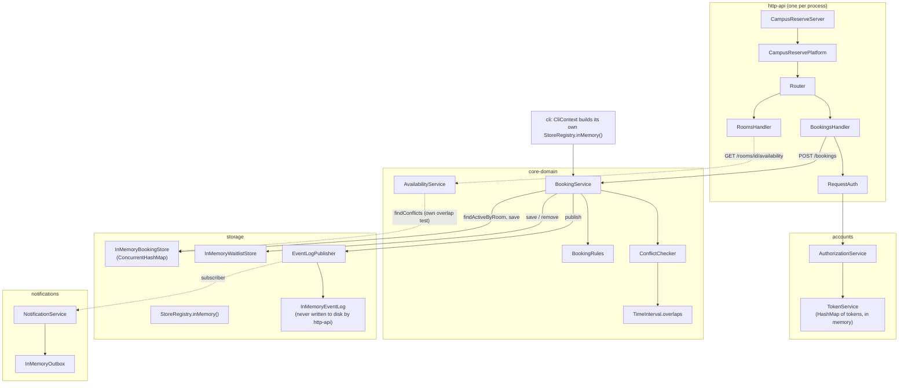

# BOUNDARIES.md

---

## Milestone 1: The architecture as built

**The sketch.** Every arrow below is something I can point at: a constructor
call in `CampusReservePlatform` (or `CliContext`), or a method call in the
class it starts from. Solid arrows are the booking path, dashed arrows are the
availability path.



To predict where a change goes: booking rules live in `core-domain`, anything
about what is stored or how it is queried lives in `storage`, tokens live in
`accounts`, and the wiring for the HTTP side is all in
`CampusReservePlatform`.

**Where your sketch and `ARCHITECTURE.md` disagree.**

1. Availability doesn't go through `BookingService` or `ConflictChecker` at
   all. It goes `RoomsHandler` → `AvailabilityService` →
   `BookingStore.findConflicts`, and `ARCHITECTURE.md` never draws that path.
2. `ARCHITECTURE.md` (and `AGENTS.md` rule 3) says `TimeInterval.overlaps` is
   the only overlap implementation. `InMemoryBookingStore.findConflicts`
   writes its own (`start.isBefore(windowEnd) && windowStart.isBefore(end)`),
   and availability depends on it.
3. `ARCHITECTURE.md` says the event log is "the one thing that can outlive a
   process". For the HTTP server it can't: `CampusReservePlatform` builds
   `StoreRegistry.inMemory()`, so booking events made over HTTP only ever go
   into a list in memory.
4. The repo's drawing shows one platform. Running it as copies gives each
   process its own stores and its own `TokenService`, which is the whole of
   Milestone 2. I drew that in. The repo doesn't.

**How you decided which one is right.**

1. I read the wiring. `CampusReservePlatform` builds
   `new AvailabilityService(stores.bookings(), policy)` and hands it to
   `RoomsHandler`. `AvailabilityService` imports `BookingStore` and nothing
   from `policy/` besides `BookingPolicy`. It never calls `ConflictChecker`.
2. I grepped `src/main` for `overlaps` and `findConflicts`. The comparison is
   in `InMemoryBookingStore.java`, and `storage/.../FindConflictsTest.java`
   pins it as storage behavior. Right now it gives the same answer as
   `overlaps`, but nothing ties the two together, so they can drift apart.
3. I grepped for callers of `withEventLogFile` and `JsonlFileEventLogWriter(`.
   Outside tests there are none. Both entry points call
   `StoreRegistry.inMemory()` (`CampusReservePlatform.java:44`,
   `CliContext.java:54`).
4. Checked at runtime: the two scripts in Milestone 2.

---

## Milestone 2: Run it as copies

**Your stack.**

```
docker compose up -d --build --scale api=2
docker compose logs api | grep u-1        # each copy's member token
docker compose run --rm --no-deps k6 run /load/<script>.js -e ...
```

The token run saw **2** distinct `X-Upstream` values (`172.19.0.2:8080` and
`172.19.0.3:8080`). The booking script skips the proxy, so I log which copy
answered each request instead.

### Finding 1: tokens

**The claim.** A token works on any request, whichever copy answers it.

**The script and its result.** `load/tokens.js` sends api-1's u-1 token
through the proxy 40 times (`GET /bookings`) and checks every response is
200. Thresholds: `checks{claim:token-works-on-any-copy}` must be `rate==1`,
and `distinct_upstreams` must be `>=2`, so a run that only reached one copy
can't pass by accident.

```
distinct X-Upstream values: 2
  172.19.0.2:8080  200: 0   other: 17
  172.19.0.3:8080  200: 23  other: 0
✗ 'rate==1' rate=57.49%
```

Every request that reached the other copy got
`401 {"error":"invalid_token"}`. As a control I scaled to one copy and ran it
with `-e MIN_UPSTREAMS=1`, and it passed with 40/40. So I've seen it both
pass and fail, and the thing it fails on is exactly the claim.

**Why, from the code.** `TokenService` keeps tokens in a plain
`LinkedHashMap<String, Token> byValue` field. `CampusReservePlatform` calls
`new TokenService(accounts, clock, TokenMinter.random())` once per process,
and `CampusReserveServer.main` issues the printed tokens into that one map.
Copy B's map never sees copy A's token, so `authenticate` comes back empty
and `RequestAuth` turns that into a 401. I found it by following
`RequestAuth.require` → `AuthorizationService` → `TokenService.authenticate`.

**The kind of problem.** Session state kept in process memory, in a service
that is being scaled as if it were stateless. Each replica has its own
session store, so the system only works with sticky sessions (or a shared
token store).

### Finding 2: bookings

**The claim.** A room slot is booked at most once.

**The script and its result.** `load/bookings.js` asks for the same room
(`r-1`) and the same hour tomorrow on each copy, sending each request straight
to `http://f26-lab09-api-1:8080` and `http://f26-lab09-api-2:8080` with that
copy's own token. It has to skip the proxy because, through the proxy, about
half the requests would bounce off as 401 (Finding 1) and never test the slot.
Thresholds: `confirmed_bookings` must be `count<=1`, and a check that exactly
one request was confirmed. Afterwards it cancels what it booked, so it can be
run again.

```
http://f26-lab09-api-1:8080  r-1 2026-10-30T10:00:00Z  201 confirmed
http://f26-lab09-api-2:8080  r-1 2026-10-30T10:00:00Z  201 confirmed
✗ 'count<=1' count=2
```

Control: both requests sent to api-1 (as u-1, then as u-2) gave `201
confirmed` and then `202 waitlisted`, and the run passed.

**Why, from the code.** `BookingService.requestBooking` reads
`bookings.findActiveByRoom(roomId)`, asks `ConflictChecker`, and then calls
`bookings.save`. The `BookingStore` it reads is the `InMemoryBookingStore`
that this process's `StoreRegistry.inMemory()` built, so copy B's check can't
see copy A's booking. Inside one copy the check-then-save is safe in practice
because `HttpApiServer` calls `server.setExecutor(null)`, which means one
dispatcher thread handles every request. Across copies nothing serializes
them, and there's no shared store to do it either. Booking ids don't collide
(`IdGenerator.random()` uses UUIDs), which is why the double booking goes
through without any error.

**The kind of problem.** A broken invariant across replicas. The
"no overlapping bookings for a room" invariant is checked against
process-local state, so it is really a check-then-act race with no single
owner of the data. Each copy is consistent with itself, and the two together
are split-brain.

### What you checked

My agent suggested that `requestBooking` could double-book even on **one**
copy under concurrent load, because it reads and then writes with no lock.
I checked `HttpApiServer` and found `server.setExecutor(null)`, which runs all
handlers on the server's single dispatcher thread. I also ran the one-copy
control above, which came back 201 then 202. So the within-copy race is real
in the code's shape but can't happen with this wiring, and the double booking
we saw comes from the copies, not from threads.

---

## Milestone 3: One boundary

Problem: Finding 2. A slot can be confirmed once per copy.

**The boundary.** The `BookingStore` port in `core-domain/core/ports`, with
one change: booking a slot becomes a single store operation,
`saveIfFree(Booking) → Saved | Conflict`, instead of
`findActiveByRoom` followed by `save`. The store promises that it decides
"is this room free over this interval?" and stores the booking in one atomic
step that every copy goes through. `storage` implements it with a new
`SharedBookingStore` backed by one database that all copies point at.
`WaitlistStore` moves with it, because promotion reads bookings and writes the
waitlist together, and `nextSequence()` has to be one counter rather than one
per copy.

What moves: the booking and waitlist data, out of each process and into the
shared store. What stays: `BookingService`, `BookingRules`, and
`ConflictChecker` stay in `core-domain` and still decide everything except the
final "is it still free" at write time.

**Who owns the data.** `storage` owns bookings and waitlist entries, through
`SharedBookingStore`. `BookingService` is the only caller allowed to write
through the port (that's already rule 4 for the waitlist, and this extends it
to bookings). Everyone else, including `AvailabilityService`, the CLI, and
`billing`, can only read.

**The one invariant that must not cross.** No two bookings that hold the same
room have overlapping intervals. Any code that saves a booking based on a
conflict check it did in an earlier, separate read violates it. Only
`saveIfFree` may decide.

**What the boundary costs.**

- An interface to keep: `BookingStore` grows a method, and
  `InMemoryBookingStore` plus the test fake in `core-domain/src/test/.../InMemoryStores`
  both have to implement it. `BookingService`'s create, modify, and promote
  paths all change to use it, and so do their tests in `core-domain`.
- A second implementation to maintain: the in-memory store for tests and the
  CLI, and the shared one for the server. Both need the same contract tests,
  or they will quietly disagree.
- A performance argument to have again: a booking today is an in-process map
  read (median about 0.7 ms per request in the k6 run). With this change every
  booking, and every availability query, becomes a network round trip plus a
  lock or constraint check, so roughly a few ms more per request and
  contention on busy rooms. The `findConflicts` "one pass" optimization has to
  be redone as a query and an index.
- A rule to rewrite: if the database enforces overlap itself (for example an
  exclusion constraint on room and time range), that is a third overlap
  predicate and breaks `AGENTS.md` rule 3. The rule has to be changed on
  purpose, with a test that the store and `TimeInterval.overlaps` agree on
  the half-open edges.
- New failure modes: the shared store can be down, and then nobody can book on
  any copy. Today a copy never depends on anything outside itself.

What it leaves unfixed: tokens are still per copy (Finding 1 needs its own
boundary, either a shared token store or signed tokens). The event log and the
notification outbox are still per process and in memory, so analytics would
only see one copy's events. And the second overlap test in
`InMemoryBookingStore.findConflicts` from Milestone 1 is still there.
